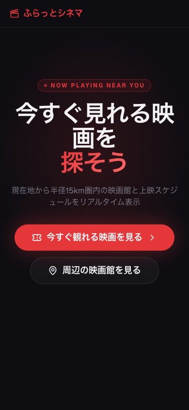
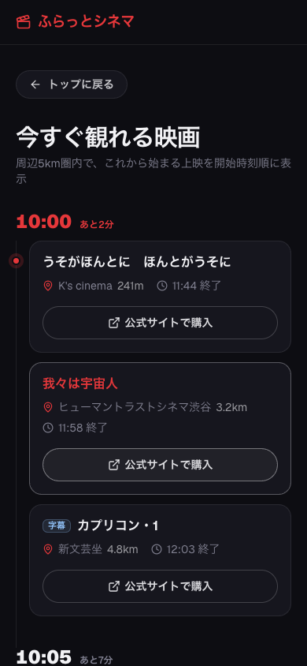

# ふらっとシネマ

思い立ったらすぐ映画へ。現在地から近くの映画館と、これから始まる上映を探せる Web アプリです。

**公開中のサイト → https://furatto-cinema.vercel.app** （位置情報の許可が必要です。スマートフォンでの表示を想定しています）

<p>
  
  
</p>

- **今すぐ観る**: 周辺5km圏内で、これから始まる上映を開始時刻順に表示
- **周辺の映画館**: 5 / 10 / 15km 圏内の映画館と、各館の上映スケジュール
- **お気に入り**: よく行く映画館を保存

映画館と上映スケジュールは [映画.com](https://eiga.com) の掲載情報をもとにしています。映画館の場所・写真は Google Places API から取得します。

## 使った技術

| 部分 | 技術 |
| --- | --- |
| 画面・サーバー | Next.js 16（App Router）、React 19、TypeScript |
| 見た目 | Tailwind CSS、shadcn/ui |
| 上映スケジュールの取得 | サーバー側で HTML を読み取り（cheerio） |
| 外部データ | Google Places API（映画館の場所・写真） |
| 公開 | Vercel |

画面から直接外部サイトを呼ばず、Next.js の API ルート（`app/api/`）でまとめて取得・整形してから返しています。お気に入りはブラウザに保存します。

## 開発

```bash
npm install
npm run dev
```

http://localhost:3000 で起動します。`.env.local` に次の環境変数が必要です。

```
GOOGLE_PLACES_API_KEY=...
```

編集したのに画面の一部が古いまま、ハイドレーションエラーが出る、といったときは `.next` を消して起動し直してください。

```bash
rm -rf .next && npm run dev
```
